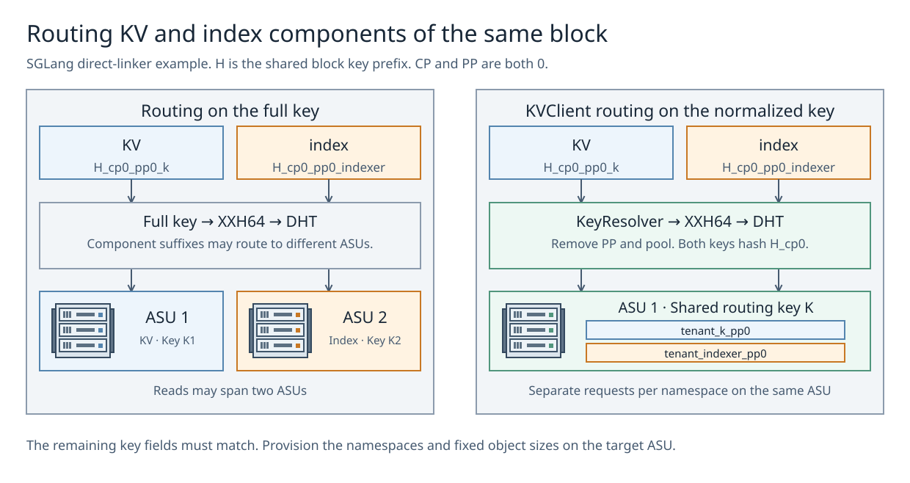
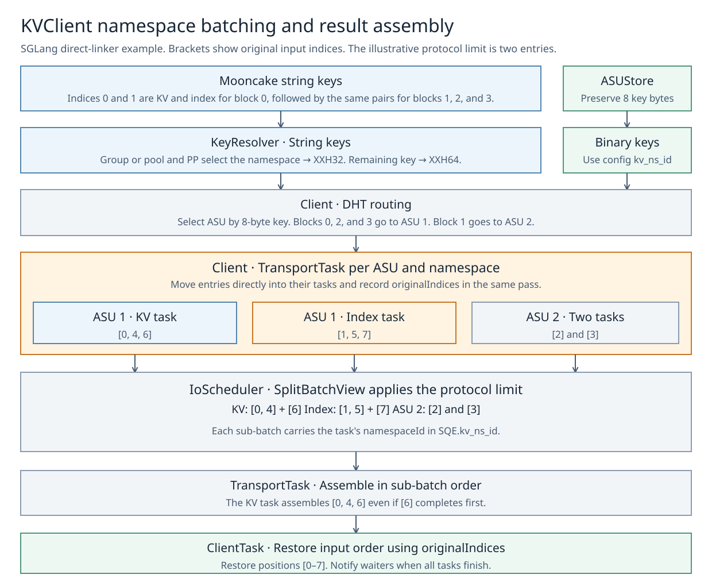

# KVClient Key and Namespace Design

[简体中文](../zh/kvclient-key-and-namespace-design.md)

KVClient supports batch operations across multiple ASUs and namespaces. For a string key, KVClient extracts the namespace fields, combines them with the base namespace to form the target namespace name, and removes the extracted fields from the original key. KVClient hashes the target namespace name and the remaining key separately to produce the namespace ID and the 8-byte key.

KVClient uses the 8-byte key to select the target ASU and groups requests by target ASU and namespace. Each ASU request carries one namespace ID. Within an ASU, the key and namespace together identify an object. The size of each object written must match the fixed size configured for its namespace on the target ASU.

## 1. Data structures

| Structure | Responsibility |
| --- | --- |
| `CacheKey`, `KVBuffer` | Public input types. Query and Delete take keys. Load and Store take entries containing a key, data buffer, and offset |
| `ResolvedCacheKey`, `ResolvedKVBuffer` | Internal entries. A resolved key contains an 8-byte object identifier and a 32-bit namespace ID. Data buffers and offsets retain the caller-supplied values |
| `TransportTask` | Groups entries for one ASU and one namespace. It holds the protocol `namespaceId` and the `originalIndices` used to assemble results |

## 2. Key and namespace resolution

`KeyResolver` processes each key before routing. The string path uses `IoOptions::kvns` as its base namespace. The binary path uses `kv_ns_id` from the ASU configuration. See the [KeyResolver implementation](../../../src/client/key_resolver.cc).

| Input | Object identifier | Namespace |
| --- | --- | --- |
| vLLM-Ascend string key | Extract and remove `@group:<rank>` and `@pp_rank:<rank>`, then encode the remaining fields | Append `_group<rank>` and `_pp<rank>`, in that order, for fields present in the key |
| SGLang direct-linker string key | Extract and remove the PP and pool suffix from a direct-linker key, then encode the remaining fields | Append `_<pool>_pp<rank>` |
| Generic string key | Encode the full string | Use the base namespace |
| Binary key | Preserve the 8 input bytes | Use `kv_ns_id` from the ASU configuration, defaulting to `0`. ASU configurations for the same client should use the same `kv_ns_id` |

XXH64 encodes the string object identifier as an 8-byte little-endian value. XXH32 derives a global namespace ID (GNSID) from the namespace name. Both hashes use seed `5381`. The `inference.engine` setting selects the parsing rules. Provision each namespace and its fixed object size on the target ASUs before use.

### 2.1 String key resolution examples

All examples use `tenant` as the base namespace. Each pair of hexadecimal digits represents one byte, shown in little-endian order.

| Engine | Input key | XXH64 input and 8-byte key | Namespace and GNSID |
| --- | --- | --- | --- |
| vLLM-Ascend | `model@tp_rank:3@group:2@pp_rank:1@cache_role:kv@hash@7` | `model@tp_rank:3@cache_role:kv@hash@7` (`0x44f5a1d66cf87354`) | `tenant_group2_pp1` (`0x6fcb430c`) |
| SGLang direct linker | `model_hash_tp0_cp0_pp1_kv` | `model_hash_tp0_cp0` (`0x2f6e0483c95b6032`) | `tenant_kv_pp1` (`0x0ec33188`) |
| SGLang direct linker | `model_hash_tp0_cp0_pp1_indexer` | `model_hash_tp0_cp0` (`0x2f6e0483c95b6032`) | `tenant_indexer_pp1` (`0xb216fdf5`) |

Within the same routing view, components of a block with identical remaining key fields route to the same ASU and are stored in their respective namespaces. This can reduce the number of ASUs involved in a read. Each namespace still uses separate protocol requests.

## 3. Routing and protocol batching

1. **Select an ASU.** The DHT routes each 8-byte key and returns its original input index.
2. **Build transport tasks.** The client walks the routing results for each ASU and creates a `TransportTask` for each distinct namespace ID. It moves entries directly into their tasks and records their `originalIndices`. The underlying data buffers remain in place. See the [ClientTaskManager implementation](../../../src/client/task/task_manager.cc).
3. **Split into protocol sub-batches.** The I/O scheduler uses `SplitBatchView` to create views over contiguous task entries, subject to the entry limit for the operation. Each sub-batch inherits the task's `namespaceId` and writes it into the submission queue entry (SQE) as `kv_ns_id`. See the [IoScheduler implementation](../../../src/trans/task/io_scheduler.cc).

The protocol currently uses the GNSID from the string path or the ASU configuration value `kv_ns_id` from the binary path directly. `GetTargetNamespaceId()` is the point at which the protocol ID is selected. View-based translation from global IDs to ASU-local IDs remains unimplemented.

