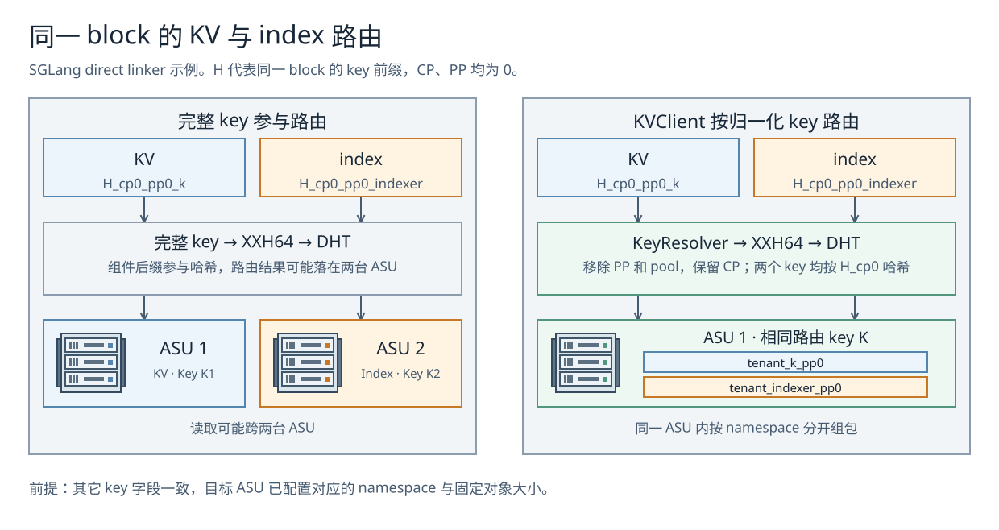
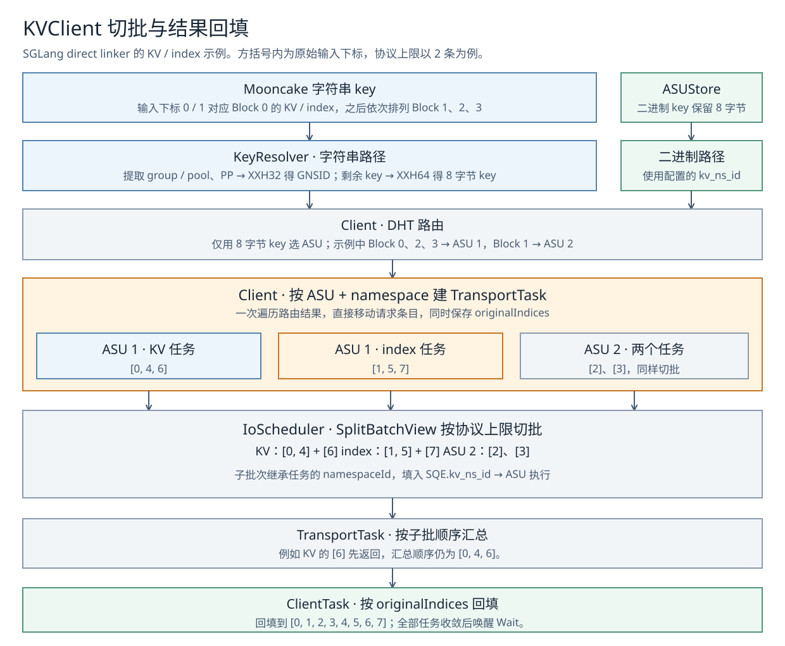

# KVClient Key 与命名空间设计

[English](../en/kvclient-key-and-namespace-design.md)

KVClient 支持在一次批量操作中访问多个 ASU 和命名空间。处理字符串 key 时，KVClient 提取命名空间字段，将其与基础命名空间组合为目标命名空间名称，并从原始 key 中移除已提取的字段。KVClient 分别对目标命名空间名称和剩余 key 计算哈希，得到命名空间 ID 和 8 字节 key。

KVClient 根据 8 字节 key 选择目标 ASU，再按目标 ASU 和命名空间组织请求。每条 ASU 请求携带一个命名空间 ID。同一 ASU 内的对象由 key 和命名空间共同标识，写入的对象大小须与目标 ASU 上该命名空间的固定配置值一致。

## 1. 数据结构

| 结构 | 职责 |
| --- | --- |
| `CacheKey`、`KVBuffer` | 对外输入。Query 和 Delete 接收 key，Load 和 Store 接收包含 key、数据缓冲区及偏移的条目 |
| `ResolvedCacheKey`、`ResolvedKVBuffer` | 内部条目。解析后的 key 包含 8 字节对象标识和 32 位命名空间 ID，数据缓冲区和偏移沿用调用方输入 |
| `TransportTask` | 管理发往同一 ASU 且属于同一命名空间的条目，持有协议 `namespaceId` 和用于结果归并的 `originalIndices` |

## 2. Key 与命名空间解析

`KeyResolver` 在路由前处理每个 key。字符串路径使用 `IoOptions::kvns` 作为基础命名空间。二进制路径使用 ASU 配置中的 `kv_ns_id`。参见 [KeyResolver 实现](../../../src/client/key_resolver.cc)。

| 输入 | 对象标识 | 命名空间 |
| --- | --- | --- |
| vLLM-Ascend 字符串 key | 提取并移除 `@group:<rank>` 和 `@pp_rank:<rank>`，编码其余字段 | 按出现的维度依次追加 `_group<rank>` 和 `_pp<rank>` |
| SGLang direct linker 字符串 key | 对符合 direct linker 格式的 key，提取并移除 PP 和 pool 后缀，编码其余字段 | 追加 `_<pool>_pp<rank>` |
| 通用字符串 key | 编码完整字符串 | 使用基础命名空间 |
| 二进制 key | 保留输入的 8 字节 | 使用 ASU 配置中的 `kv_ns_id`，缺省为 `0`。同一客户端的 ASU 配置应采用相同的 `kv_ns_id` |

字符串对象标识通过 XXH64 编码为 8 字节小端值。命名空间名称通过 XXH32 生成全局命名空间 ID（GNSID）。两种哈希均使用种子 `5381`。解析规则由 `inference.engine` 选择。部署时应在目标 ASU 上预先配置所用命名空间及其固定对象大小。

### 2.1 字符串 key 解析示例

以下示例的基础命名空间均为 `tenant`。8 字节 key 以小端顺序展示，每两位十六进制数字表示一个字节。

| 引擎 | 原始 key | XXH64 输入与 8 字节 key | 命名空间与 GNSID |
| --- | --- | --- | --- |
| vLLM-Ascend | `model@tp_rank:3@group:2@pp_rank:1@cache_role:kv@hash@7` | `model@tp_rank:3@cache_role:kv@hash@7` (`0x44f5a1d66cf87354`) | `tenant_group2_pp1` (`0x6fcb430c`) |
| SGLang direct linker | `model_hash_tp0_cp0_pp1_kv` | `model_hash_tp0_cp0` (`0x2f6e0483c95b6032`) | `tenant_kv_pp1` (`0x0ec33188`) |
| SGLang direct linker | `model_hash_tp0_cp0_pp1_indexer` | `model_hash_tp0_cp0` (`0x2f6e0483c95b6032`) | `tenant_indexer_pp1` (`0xb216fdf5`) |

在同一路由视图中，同一 block 的各组件在剩余 key 字段一致时会路由到同一 ASU，并分别存储在各自的命名空间中。这可以减少读取涉及的 ASU 数量，各命名空间仍独立组包。

## 3. 路由与协议切批

1. **选择 ASU。** DHT 根据 8 字节 key 路由并返回原始输入下标。
2. **创建传输任务。** Client 按 ASU 遍历路由结果，每遇到一个新的命名空间 ID 就创建一个 `TransportTask`。请求条目直接移入所属任务，同时记录 `originalIndices`。缓冲区数据留在原位置。参见 [ClientTaskManager 实现](../../../src/client/task/task_manager.cc)。
3. **切分协议子批次。** IoScheduler 通过 `SplitBatchView` 根据操作类型的条目上限，从任务的连续条目中生成子批视图。所有子批次继承任务的 `namespaceId`，并将其写入提交队列条目（SQE）的 `kv_ns_id` 字段。参见 [IoScheduler 实现](../../../src/trans/task/io_scheduler.cc)。

当前协议直接使用字符串路径的 GNSID 或二进制路径的 ASU 配置项 `kv_ns_id`。`GetTargetNamespaceId()` 是确定协议 ID 的位置。全局 ID 到 ASU 本地 ID 的视图映射尚未接入。

